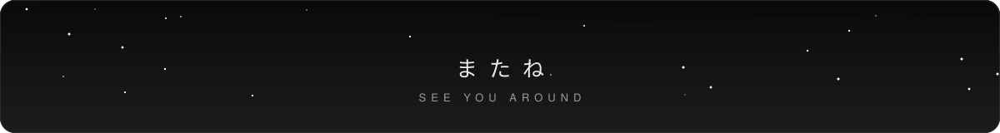

  

  

<table>
  <tr>
    <td><a href="https://github.com/n0tmar/0mar-lol"><b>0mar.lol</b></a></td>
    <td>Personal site and experiments</td>
    <td><code>TypeScript</code></td>
  </tr>
  <tr>
    <td><a href="https://github.com/n0tmar/streamariptv"><b>streamariptv</b></a></td>
    <td>IPTV streaming tool</td>
    <td><code>WIP</code></td>
  </tr>
  <tr>
    <td><a href="https://github.com/n0tmar/Mar-Tools"><b>Mar Tools</b></a></td>
    <td>Release hub for Mar Tools desktop apps</td>
    <td><code>Releases</code></td>
  </tr>
</table>

 

 

  

  

